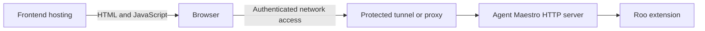

# Roomote Control Demo

A mobile-friendly interface for Roo Code tasks through Agent Maestro. It supports connection selection, task history, SSE updates, and task actions. This is an integration example, not an independently authenticated backend.

## Local Development

Install and start Agent Maestro with a Roo-compatible extension. From this directory:

```bash
pnpm install
pnpm dev
```

Open `http://localhost:3000/roo` and connect to the AM HTTP origin, normally `http://127.0.0.1:23333`. The main UI is [src/app/roo/page.tsx](src/app/roo/page.tsx); API and streaming helpers are under [hooks](src/app/roo/hooks/).

## Remote Access

**Configure authenticated access before publishing a tunnel or opening a firewall port.** AM rejects browser requests from origins it does not allow, so first add the demo's origin (for example `http://localhost:3000` or your Vercel URL) to `agent-maestro.proxyServerCorsOrigins`.

The demo sends no API authentication header. Once any AM key is set, `/api/v1` requires the Admin API Key, so the demo stops working. To use it remotely, put it behind an access-controlled tunnel, VPN, or reverse proxy that does not require AM keys, and verify that unauthenticated requests from elsewhere are rejected. Apply the policy to the API origin, not just the frontend deployment. A frontend login alone is insufficient.

To host the UI on Vercel, import this directory as the project root and use the checked-in [vercel.json](vercel.json). Enter the protected AM origin in the connection screen after verifying access from the intended browser/device.

### Network Path and CORS

The deployment serves the UI; API traffic goes from the browser directly to the configured origin:



Changing CORS headers on Vercel's frontend does not configure AM's API; use `agent-maestro.proxyServerCorsOrigins`. Origin policy is not authentication; use network or gateway access controls as well.

## SSE Integration

Follow the [AM Roo HTTP/SSE contract](../../docs/roo-routes-events.md). Events use camelCase names such as `taskCreated` and `taskCompleted`, with JSON object payloads.

`taskCompleted` can precede final message content and is not a terminal event. Keep reading until AM closes after a complete follow-up/completion-result message or an abort. Do not finalize using a fixed delay, and distinguish an unexpected disconnect from successful completion. The old `task_completed` and `stream_closed` names are not emitted.

Review endpoint URLs and logs before sharing them. Do not put access credentials into source control.
